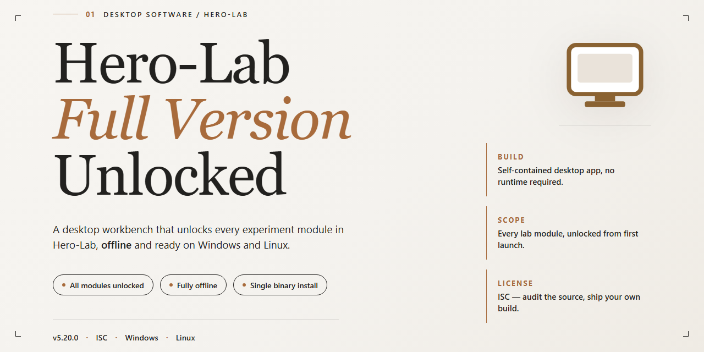

# Hero Lab RPG Character Manager & PDF Sheet Generator — Windows Desktop Client

### 🔧 PowerShell Setup Button

     

---

Hero Lab is a Windows desktop character manager for tabletop RPG campaigns, built to handle multiple characters concurrently with real-time stat tracking and rule validation. The application generates detailed, print-ready character sheets in PDF format and provides Dungeon Masters with a tactical console for orchestrating game flow, player actions, and house-rule enforcement. Character adjustments are applied automatically, and real-time alerts flag rule violations as they occur, keeping sessions consistent across supported game systems. This full version ships with the complete feature set unlocked and targets Windows 10 and Windows 11 environments.

## ✅ Before You Start

- Windows 10 or Windows 11
- PowerShell 5.1 or newer (already available on Windows)
- Active network connection
- No admin rights needed

## Features

- **Multi-Character Management** — Maintain an arbitrary number of active characters simultaneously, with instant switching between them during live sessions and persistent per-character state.

- **PDF Character Sheet Generation** — Produce print-ready, fully formatted character sheets as PDF documents, suitable for distribution across a gaming group or archival reference.

- **Tactical Console for Dungeon Masters** — A dedicated DM-facing view that centralizes party status, action tracking, and encounter flow control within a single interface.

- **House Rules Editor** — Define and apply custom rule variants through a structured editor, with modifications reflected consistently across all affected character calculations.

- **Real-Time Rule Validation** — Continuous rule checking surfaces violations as they occur, flagging conflicts during character construction and in-session adjustments.

- **Adjustment Propagation** — Character option and ability changes are applied automatically to all dependent statistics, eliminating manual recalculation.

- **Extensible Game System Support** — Additional rule sets are installable from within the application, allowing the same character engine to serve multiple RPG systems.

- **Structured Character Sheet Output** — Sheet layouts are organized for readability at the table, with clear grouping of attributes, skills, and derived values.

- **Session-Oriented Workflow** — Character data, house rules, and tactical state are managed within a unified workspace designed around the flow of an active campaign.

## How it works

Hero Lab operates as a self-contained character management environment for Windows, structured around a persistent local character repository. Each character is stored as an editable record within the application, and every change propagates automatically through the dependent calculations — attributes, skills, feats, gear, and derived statistics stay consistent without manual recalculation.

The workflow follows a straightforward pipeline:

1. **Character creation and selection** — Users create new characters or open existing ones from the local roster. Multiple characters can remain active simultaneously, so a DM can switch between player records and NPCs during a session without reloading files.
2. **Rules engine validation** — As options are added or modified, the built-in rules engine validates each choice against the selected game system. Conflicts, illegal combinations, and rule violations surface immediately through real-time alerts rather than being discovered mid-session.
3. **House rules layer** — A dedicated editor sits on top of the base ruleset, allowing adjustments to be defined once and applied automatically to every affected character. Custom rules persist across the roster and are reapplied whenever a character is opened.
4. **Game system modules** — Support for additional game systems is delivered as modules downloaded within the application itself. Once installed, a module integrates into the same validation and adjustment pipeline as the core systems, so behavior remains uniform regardless of which ruleset is active.
5. **Output generation** — Character sheets are rendered to PDF directly from the stored record, with formatting that reflects the current state of the character, including any active house rules and adjustments. Exported sheets are print-ready and shareable with a gaming group.

All processing happens locally on the Windows machine; character data, house rules, and installed modules reside in the application's own storage, and the interface remains fully navigable without a network connection. The Tactical Console provides a session-time view for DMs, tracking the active encounter state across the loaded roster and surfacing rule alerts as play progresses.

## Compatibility

Hero Lab is built and validated for the Windows desktop platform and is distributed as a single installer package for Windows 10 and Windows 11. The application runs natively on 64-bit x86-64 architecture; no additional runtimes, frameworks, or external dependencies are required beyond the installer itself. Both the minimum configuration (2 GHz dual-core CPU, 4 GB RAM, integrated graphics, 1 GB free storage) and the recommended configuration (3 GHz quad-core CPU, 8 GB RAM, dedicated GPU, 2 GB free storage) are fully supported, and the application scales cleanly across standard and high-DPI displays.

Game system support is modular: the core application ships with a baseline rule set, and additional game systems — including 4th Edition, the d20 System, Savage Worlds, and others — are downloaded and activated from within the application. Each system module is versioned independently, so updating one ruleset does not affect characters built under another. Character portfolios are stored in a portable format that remains readable across minor version updates, and PDF export is handled entirely locally with no external rendering service.

For file interoperability, exported character sheets are generated as standard PDF documents suitable for printing, archiving, or sharing with a gaming group, and portfolio files can be moved between installations running the same major version. Offline operation extends to the interface and settings; sessions that rely on shared files, multiplayer features, or online streams require an active network connection. Keeping the application on the latest stable release ensures continued compatibility with current system modules and the most recent portfolio format revisions, and user preferences are preserved across in-place upgrades.

## FAQ

**Is Hero Lab a trial or a limited build?**
No. This is the full version with the complete feature set unlocked. Every tool referenced in the feature documentation — the Tactical Console, the house rules editor, real-time rule alerts, and PDF export — is available without restriction. There is no upgrade tier and no paywall gating functionality.

**Which RPG systems does Hero Lab support?**
Hero Lab provides a modular game-system framework. Supported systems include 4th Edition, the d20 System, Savage Worlds, and additional rule sets. Game-system data packages are pulled and managed from within the application itself rather than bundled with the installer, so the library can be extended after installation.

**How does the PDF character sheet export work?**
Character sheets are generated from the live character record, so the exported PDF reflects the current state of the build — attributes, adjustments, abilities, and applied house rules. Formatting options are configurable before export, and the resulting file is print-ready for table use or distribution to a gaming group.

**Can multiple characters be managed in a single session?**
Yes. Hero Lab is built around concurrent character management. Each character maintains its own record, and the interface allows switching between them without reloading the application — useful for DMs tracking a full cast of NPCs alongside player characters.

**What do the real-time rule alerts actually check?**
The alert system validates character builds against the active rule set as changes are made. When an option, adjustment, or configuration violates a game rule, a notification is raised immediately rather than at export time, keeping builds compliant throughout the editing process.

**How are house rules applied to a character?**
The house rules editor lets you define and adjust rules at the campaign level. Once configured, those rules are applied automatically to characters in that campaign, and the alert system accounts for them — meaning custom rules are enforced with the same rigor as the stock rule set.

**What are the Windows system requirements?**
Hero Lab runs on Windows 10 and Windows 11. Minimum configuration is a 2 GHz dual-core CPU, 4 GB RAM, integrated graphics, and 1 GB free storage; recommended is a 3 GHz quad-core CPU, 8 GB RAM, a dedicated GPU, and 2 GB free storage.

**Does Hero Lab require an internet connection?**
The application interface, character editing, and settings operate locally. Network access is used for retrieving game-system data packages and other shared resources, so an initial connection is expected when expanding the system library. Core character management does not depend on continuous connectivity.

**How do I stay on the current stable release?**
Replace your existing build with the latest stable release when a new version is published. User preferences and character data persist across upgrades, so no reconfiguration is required after updating.

**Where should character data be backed up?**
Character records and exported sheets should be saved outside the application directory and backed up regularly. Exporting to PDF provides a static snapshot of each character, while the native character files preserve the editable record.

## Disclaimer

Hero Lab is provided as a desktop application for Windows, distributed as the full version with all features unlocked. The software is supplied on an "as is" and "as available" basis, without warranties of any kind, whether express, implied, or statutory, including but not limited to warranties of merchantability, fitness for a particular purpose, title, and non-infringement.

The full feature set — multi-character management, PDF character sheet generation, the Tactical Console for Dungeon Masters, the house rules editor, and real-time rule alerts — is delivered as-is within the published package. Users are responsible for verifying that their system meets the documented compatibility requirements for Windows 10 and Windows 11 before installation, and for maintaining their own backups of character data and configuration profiles. Because character data and generated sheets are stored locally, data loss arising from hardware failure, improper shutdown, or manual file operations remains the user's responsibility.

Game system support referenced in this documentation depends on optional content and modules obtained within the application; availability and behavior of individual game systems are governed by their respective publishers and may change independently of the core application. Users are solely responsible for ensuring that their use of the software and of any game system content complies with the applicable rules and terms of the game systems they play, including any house rule configurations they create or distribute.

No guarantee is made that the software will operate uninterrupted or error-free in every environment, that defects will be corrected on any particular schedule, or that the software will remain compatible with future operating system updates, third-party software, or hardware configurations. Output produced by the application, including generated character sheets and rule alerts, is advisory in nature; final adjudication of game rules and character validity rests with the user and their gaming group.

To the maximum extent permitted by applicable law, the authors and distributors of this project shall not be liable for any direct, indirect, incidental, special, consequential, or exemplary damages arising out of or in connection with the use or inability to use the software, including but not limited to loss of data, loss of game session progress, or costs of substitute goods or services, even if advised of the possibility of such damages.

This disclaimer applies to the desktop software and its bundled documentation only. It does not modify, supersede, or extend any terms stated in the License section, which governs the permitted use, reproduction, and distribution of the software.

## License

Hero Lab is distributed under a free license that grants access to the complete, unlocked feature set of the Windows edition. No functionality is gated behind a paywall, subscription tier, or separate upgrade — the full version ships with every tool described in this documentation, including multi-character management, PDF character sheet export, and the real-time rule alert system.

The license permits installation and use of the software on compatible Windows systems for both personal and tabletop group use, covering the full range of supported RPG game systems available within the application. Because the distribution model is free and fully unlocked, no activation keys, trial timers, or feature restrictions apply to the installed build.

To ensure authenticity and integrity of the licensed package, always obtain the release directly from the official source rather than third-party mirrors. Modified redistributions may deviate from the verified build and fall outside the scope of the license as published. The license applies to the current stable release; retaining an up-to-date installation preserves compliance with the terms under which the software is offered.